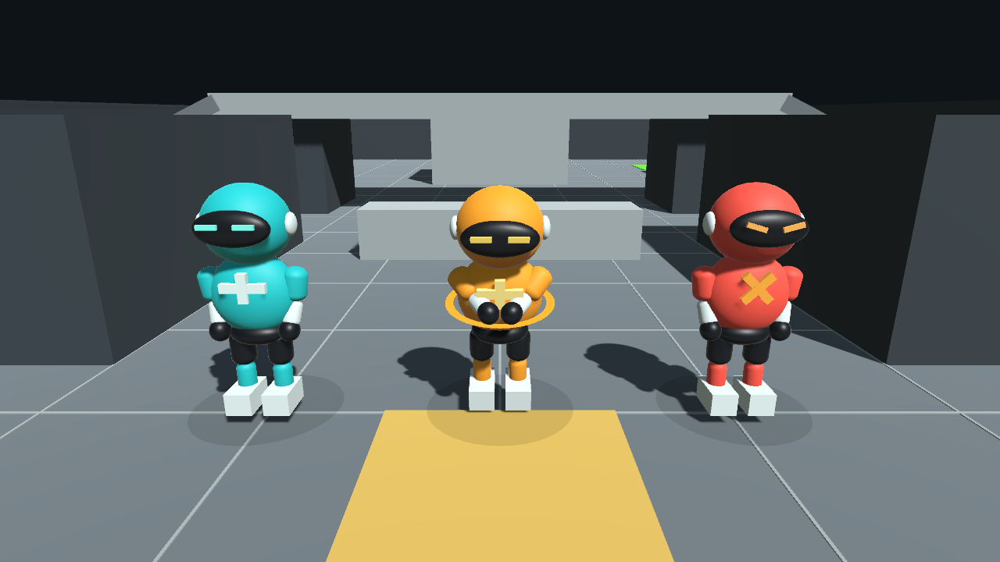
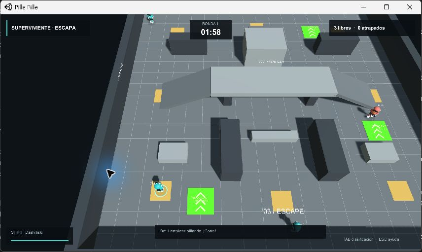

# Pille Pille

Prototipo 3D de persecución, infección y rescate desarrollado en **Unity 2020.3.49f1** para GameJam Plus (Unidad 3).

**[Descargar el juego para Windows](https://github.com/JosuePadillaUnivalle/PillePille/releases/latest/download/PillePille_Pulido.zip)** · **[Ver el GDD del equipo](GDD_PillePille_Equipo.pdf)**

## Jugar

1. Descarga el ZIP desde el enlace anterior o desde **Releases**.
2. Extrae **todo** su contenido. Conserva `PillePille_Data`, `MonoBleedingEdge` y `UnityPlayer.dll` junto al ejecutable.
3. Abre `PillePille.exe`. No necesitas instalar Unity para jugar.
4. Selecciona **Infección → Superviviente → Jugar con bots**. Puedes elegir **Infectado** si prefieres perseguir.

## Mecánicas

- **Infección:** cada captura deja al superviviente atrapado durante 10 segundos. Un compañero libre puede salvarlo manteniendo **E durante 1 segundo**, cerca y sin una pared entre ambos. Soltar E, alejarse o ser atrapado cancela el rescate.
- **Rescates repetidos:** puedes salvar al mismo jugador varias veces por ronda. Cada nueva captura vuelve a dejarlo atrapado con 10 segundos completos para recibir ayuda; se infecta si el plazo vence. El infectado inicial no se cura.
- **Protección:** al completar el rescate, ambos reciben 3 segundos de inmunidad.
- **Victoria:** los supervivientes deben seguir libres hasta acabar los 120 segundos. La infección gana si ya no quedan jugadores libres.
- **Supervelocidad:** tres baldosas conceden +50 % de velocidad durante 10 segundos. Cada baldosa tiene 20 segundos de recarga compartida; el efecto se renueva y no se acumula.
- **Bots:** navegación por rutas alrededor de obstáculos, rampas, persecución, huida y rescate de aliados.
- **Otros modos:** Clásico (pasar la mancha) y Relevo (pasar una bomba antes de que termine su cuenta atrás).

## Controles

- **WASD / flechas:** moverse.
- **Espacio:** saltar.
- **Shift:** dash.
- **E sostenida 1 segundo:** rescatar, solo si eres un superviviente libre junto a un atrapado.
- **Tab:** clasificación.
- **Esc / F1:** ayuda y menú; pausa en práctica local.
- **M:** activar o silenciar sonido.

## Multijugador LAN

Admite de 2 a 8 participantes, incluidos bots. Todos deben usar esta misma versión y estar en la misma red.

En el menú abre **Jugar en LAN**. Un equipo crea la sala y los demás se unen por la IP del anfitrión. El juego utiliza TCP 7777. No incluye servicio de partidas por Internet ni migración de anfitrión.

La conexión se verificó entre procesos del mismo equipo; falta comprobar dos computadoras en la red de destino.

## Abrir el proyecto en Unity

1. Clona o descarga este repositorio.
2. Añade la carpeta que contiene `Assets`, `Packages` y `ProjectSettings` a Unity Hub.
3. Ábrela con **Unity 2020.3.49f1**.
4. Abre `Assets/Scenes/PillePille.unity` y pulsa Play.
5. Para compilar Windows usa **Pille Pille → Compilar Windows**. La compilación conserva la escena actual. La opción **Crear o reconstruir escena** sí restaura el graybox.

Se incluyen el código, la escena y los recursos del proyecto. Las carpetas generadas por Unity y el ejecutable compilado no se guardan en el historial; el juego se distribuye mediante Releases.

## Verificación

- **90 comprobaciones de mecánicas:** correctas.
- **20 comprobaciones de bots:** correctas.
- **27 comprobaciones de reglas:** correctas.
- **15 comprobaciones de red entre procesos:** correctas.

Consulta [VALIDACION.md](VALIDACION.md) para conocer los informes, los procedimientos y sus límites. Las pruebas automatizadas no sustituyen una partida extensa con el equipo completo.

## Equipo

- Josue Padilla
- Santiago Roca
- Mathew Bruckner
- Mateo Roca
- Karen Caral

El prototipo parte de una base local de Pille Pille en Unity, ampliada con las mecánicas y mejoras descritas aquí.
